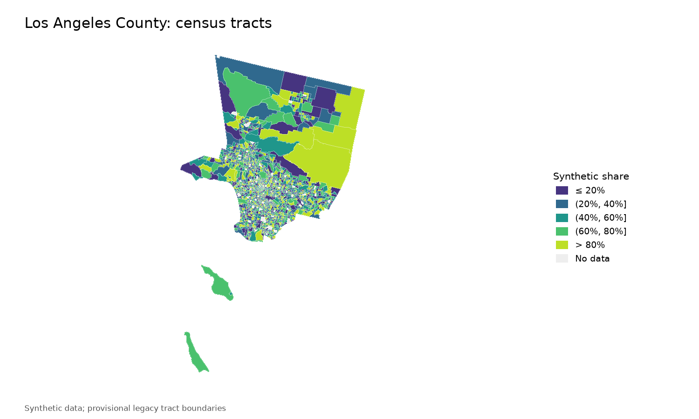

# Mapmaker

Publication-quality choropleth maps from Stata. Version **2.0.0a1** is a working
rewrite with a Stata front end and direct Python/Matplotlib rendering to PDF,
SVG, and PNG. The renderer does not use a browser or Stata's graph engine.

The alpha has been tested locally with StataNow 19.5 under `version 16` and
Python 3.14 on macOS arm64. Stata 16 and other operating systems remain test
targets. **Self-contained binary releases have not yet been built or published.**
The source version currently requires an explicit Python executable. Build tools
for a bundled interpreter are included, but the frozen runtime is unverified.

## Run the source version

From this repository, create a development environment and prepare the maps:

```sh
python3 -m venv .venv
.venv/bin/python -m pip install -r requirements.txt
.venv/bin/python tools/prepare_legacy.py county state cz tract
```

On Windows use `.venv\Scripts\python.exe` instead of `.venv/bin/python`.
The geometry preparation step uses only the standard library and the checked-in
source assets. Once dependencies and maps are prepared, rendering is offline.

Add the repository to Stata's search path, then select the development Python
explicitly. These commands do not change Stata's configured Python interpreter:

```stata
adopath ++ "/path/to/stata-mapmaker"
mapmaker income, geography(county) geovar(county_fips) ///
    nquantiles(5) colorscheme(viridis) ///
    savegraph("income.pdf") replace ///
    python("/path/to/stata-mapmaker/.venv/bin/python")
```

`id()` aliases `geovar()` and `saving()` aliases `savegraph()`. Run `help mapmaker`
for the full supported interface. `mapmaker doctor` reports installation paths
and available packs; it does not currently execute a diagnostic export.

## Current behavior

- County, state, commuting-zone, and tract choropleths using explicitly labeled
  legacy geography packs. National layouts include available Alaska, Hawaii,
  and Puerto Rico panels. Regional zoom preserves geographic vintage.
- Stata quantiles or explicit upper-inclusive cutoffs; five bins by default.
  The renderer consumes classifications computed in Stata.
- Sequential or diverging Matplotlib palettes, explicit colors, reverse colors,
  titles, notes, legend titles, percentages, and configurable numeric formats.
- PDF/SVG vector output and PNG with explicit figure size and DPI. Missing-data
  fill or hatching, polygon holes, state borders, and optional polygon rasterization.
- Duplicate/invalid-ID errors, unmatched-ID diagnostics, extended missing-value
  handling, and rejection of unsafe float tract IDs. No implicit aggregation.
- Dataset/order restoration after success or failure, independent temporary
  files, pack checksums, and atomic output commits with explicit `replace`.
- Cutoffs, bin counts, match counts, and versions returned in `r()`. Output files
  embed engine, geography-pack, and classification metadata.

The default file is `mapmaker.pdf` in the working directory. The command does not
overwrite an existing file unless `replace` is supplied. `nodisplay` suppresses
the external preview, making batch jobs independent of a graphical viewer.

## Geographic provenance

All packs in this alpha have `vintage(legacy)`. The original source and exact
boundary vintage are unverified; filenames suggesting 2010 are insufficient to
establish provenance. `vintage(2020)` is deliberately rejected. Do not present
these maps as current Census boundaries.

The compiler records source hashes, projected geometry hashes, coverage,
excluded/degenerate features, and spherical Albers projection parameters in each
pack's manifest. It uses the higher-resolution legacy county asset, and does not
apply further simplification. Rings are oriented to preserve holes. Tract
geometry contains 73,798 usable features; five source features are degenerate.
The state pack covers 50 states, DC, and Puerto Rico; other territories are
excluded and recorded. The 741 commuting zones retain their existing numeric IDs.

Generated packs live in `assets/` and can be reproduced from `tools/prepare_legacy.py`.
The source arrays are preserved in `src/geos/`. Verified Census packs, automatic
downloads, arbitrary shapefile imports, custom projections, and crosswalks are
not implemented in this alpha. Detailed design: [doc/mapmaker-v2-design.md](doc/mapmaker-v2-design.md).

## Tests and examples

```sh
.venv/bin/python -m unittest discover -s tests -v
```

From the repository root in Stata:

```stata
do tests/stata.do
do examples/smoke.do
do examples/tracts.do
```

The tests check Stata bin semantics, caller-state preservation, duplicate and
unmatched IDs, missing values, all three formats, polygon holes, failed output
replacement, checksums, and subprocess failure reporting. Examples use synthetic
data and write figures to `tests/output/`. `examples/tracts.do` plots 2,345 Los
Angeles County tracts from the legacy source.




## Building a self-contained runtime

Run on each target operating system and CPU in a clean build environment:

```sh
python -m pip install -r requirements-build.txt
python tools/build_bundle.py --python-license /path/to/cpython/LICENSE
```

The builder freezes Python, Matplotlib, dependencies, and fonts using PyInstaller,
collects license files, and stages the ado/help files with starter geography.
Use `--with-tracts` to include the large tract pack. POSIX archives use tar to
preserve symlinks and executable permissions; Windows uses ZIP. Extract a bundle
and add its top-level directory to `adopath`; `mapmaker` then selects its bundled
renderer without `python()`. `engine()` can explicitly select another built renderer.

This is an **unsigned development build path**. PyInstaller installation was
blocked by network restrictions during initial development, so it has not yet
been exercised. Signing/notarization, clean-machine tests, Linux baseline
selection, Windows shell integration, and binary distribution remain required
before a public release. Build size and startup performance of the frozen
application have not been measured. No automatic installer currently downloads code.

## Legacy version

The previous root command/help are preserved in `legacy/`. `src/` and
`stata_install/` retain the historical browser renderer and distribution for
reference. The new implementation does not invoke them. The old installer has
been removed from the new command path to prevent mixing the two runtimes.

## License

Mapmaker source is MIT licensed; see [LICENSE](LICENSE). Dependency licenses and
geographic provenance must accompany redistributed binary/data releases.
