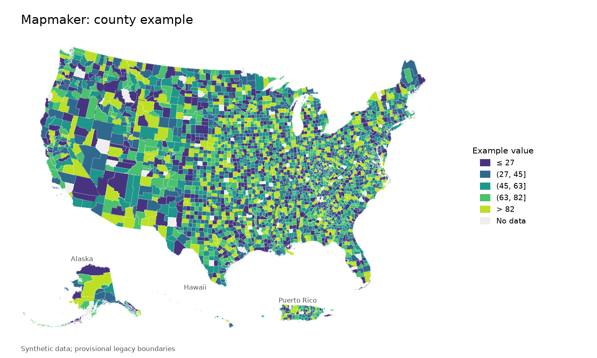

# Mapmaker

Mapmaker draws choropleth maps from Stata and saves them as PDF, SVG, or PNG.
States, counties, and commuting zones are included by default. Browse and install
optional U.S., historical, international, and environmental boundaries from Stata,
or import your own shapefile or GeoJSON. Maps support colors, legends, missing
values, regional views, and selectable projections for the new boundary packs.
Research figures add shared-scale panels, categorical/continuous/diverging and
bivariate maps, labels, outline layers, proportional symbols, uncertainty, flows,
tile maps, and Dorling cartograms. See the [research-figure guide](doc/research-figures.md)
for saved scales/styles, reproduction manifests, and explicit crosswalk allocation.



## Install

Use the **prepackaged Mapmaker bundle** with Stata 16 or newer. It includes its
own runtime, libraries, projection definitions, and default boundaries. You do
not need to install Python, create a virtual environment, or use Git.

1. Obtain the bundle for your operating system and processor. The current
   development build is `mapmaker-windows-amd64.zip` for 64-bit Windows, about
   **59 MB to download and 127 MB unpacked**. A public release has not yet been
   published; use the supplied ZIP. macOS and Linux bundles still need release
   builds and validation.
2. Extract the **entire ZIP** into a permanent folder. Keep `runtime/`, `assets/`,
   and `catalog/` alongside `mapmaker.ado`; do not copy just the ado files.
3. In Stata, add that folder and check the included geographies. Replace the
   example path with the folder containing `mapmaker.ado`:

```stata
adopath ++ "C:/Tools/mapmaker-windows-amd64"
mapmaker_setup
```

The three defaults—U.S. states, counties, and commuting zones—are ready to use.
Mapmaker selects its included runtime automatically. Repeat the `adopath` line
in new Stata sessions, or put it at the start of your project do-files. You can
also add it to your existing Stata `profile.do` for automatic startup.

Installed maps render offline. Only explicit geography installation and catalog
refresh, projection-grid installation, resource restore, and repair commands access
the network. Offline geography archive restore uses local files only. Additional
geographies download separately.

## Get started

After installation, run the included example from a writable working directory:

```stata
do "C:/Tools/mapmaker-windows-amd64/examples/quickstart.do"
```

This draws a map of five California counties using synthetic data and saves
`mapmaker-example.pdf` in your current working directory. It restores the data
you had loaded and does not overwrite an existing output file.

To map your own data, load a dataset with one row per county, a county FIPS
variable named `county_fips`, and a numeric variable named `income`. Run this
code from your project directory:

```stata
mapmaker income, geography(county) id(county_fips) ///
    nquantiles(5) legendtitle("Income") ///
    saving("income.pdf") replace
```

The command saves `income.pdf` in the current directory. Change the extension
to `.svg` or `.png` to choose another format. `replace` allows overwriting;
add `nodisplay` to skip opening the file.

## Working with your data

Compare years with one scale and retain a reproduction specification:

```stata
mapmaker income, geography(county) id(county_fips) by(year) scale(shared) ///
    scalesave("income-scale.json") manifest("income-manifest.json") ///
    saving("income-panels.pdf")
```

The packaged `examples/research-figures.do` runs synthetic panel, cartogram, and
grayscale tile examples with the installed defaults. It preserves your data.

Mapmaker uses five quantile groups by default. Use `cutvalues(10 20 30)` to set
your own cutoffs. Add `if` or `in` to select observations and `zoomtoregion` to
fit the map to those areas. Stata calculates the groups before Mapmaker draws
the map.

Store census tract IDs as strings or doubles to preserve all 11 digits.
Mapmaker reports duplicate and unmatched IDs, and shades missing values in gray.
The three default boundary packs come from the original Mapmaker project; their
dates have not been established. Dated Census packs are separate downloads.

## Browse and install geographies

```stata
mapmaker geography browse
mapmaker geography browse, installed
mapmaker geography browse, level(cd)
mapmaker geography search "PUMA"
mapmaker geography describe us_cd116_2020
mapmaker geography install us_cd116_2020
```

The Results window includes clickable details/install links, vintage, detail,
download size, and installed size. The expanded catalog covers national/state
Census families, documented ERS and Penn State commuting zones, Congresses 1–119,
Natural Earth, NUTS, Canada, Australia, the UK, geoBoundaries, watersheds,
ecoregions, and a county-level census-block pilot. All remain optional downloads.
See the [geography guide](doc/geographies.md) for editions, coverage, source terms,
ID conventions, and the exact P1–P3 scope.

```stata
mapmaker geography browse, level(tract) state(06)
mapmaker geography browse, provider(geoBoundaries) limit(20)
mapmaker geography install us_ers_cz_2020
mapmaker geography membership us_ers_cz_2020, frame(county_to_cz)
mapmaker geography install world_ne_country_110m
mapmaker geography attributes world_ne_country_110m, frame(world_names)
mapmaker geography preview world_ne_country_110m, saving("world-preview.pdf")
```

Use the complete provider ID shown by `describe` or `ids`. Census district IDs
have four digits; UCLA historical IDs use a different convention. Geographic
attributes, names, and parent IDs can be exported to a new frame or CSV.
`geography diagnose ..., id(variable) frame(checks)` reports join problems without
changing the active dataset. `geography verify pack_id` verifies installed hashes.

```stata
mapmaker income, geography(us_cd116_2020) revision(1) id(district_geoid) ///
    saving("districts.pdf") replace
```

Use `country()`, `level()`, `vintage()`, `state()`, `provider()`, `decade()`,
`search()`, and `installed` to filter the catalog. Browsing shows 50 matches by
default; use `limit()`, `offset()`, or `all` for longer lists. Optional packs live in the user's application-data directory,
not the ado directory. Override it with `datadir("path")` on **both** library and
mapping commands, or set `MAPMAKER_DATA` in the environment before starting Stata.
`mapmaker geography remove us_cd116_2020, revision(1)` removes that user-installed
revision. Bundled copies remain available. Revisions are immutable; installing a
new revision does not replace an old one, and maps default to revision 1.

`mapmaker geography refresh` explicitly downloads the catalog from this
repository's `master` branch. This becomes available when the new catalog is
published there; until then, the bundled catalog already supports installation
directly from reviewed providers. Refresh failures retain the existing catalog. Offline
catalog updates can use `mapmaker geography refresh, using("geographies.json")`.

## Projections and custom boundaries

```stata
mapmaker projection browse
mapmaker projection search "Albers"
mapmaker projection describe "EPSG:5070"
mapmaker projection recommend, geography(world_ne_country_110m) purpose(thematic)
mapmaker projection compare, geography(world_ne_country_110m) ///
    choices(equalearth robinson winkeltripel) graticule distortion ///
    saving("projection-options.pdf") replace

mapmaker income if state_fips==6, geography(us_cd116_2020) id(district_geoid) ///
    projection("EPSG:5070") zoom saving("california.pdf") replace

mapmaker geography import, using("districts.zip") name(my_districts) idfield(GEOID)
mapmaker income, geography(my_districts) id(district_id) saving("custom.pdf") replace
```

Projection definitions and algorithms are included in the bundle. `auto`
uses regional Albers projections and U.S. insets for Census packs, or Equal Earth
for custom packs. An explicit projection selects a single map panel. Named presets
cover U.S., European, Australian, and Canadian research maps, Atlantic/Pacific
world views, UTM, polar maps, distance-from-origin maps, orthographic globes,
and interrupted equal-area maps. Use
`mapmaker projection browse, all` to list projected CRSs in the bundled database.
Legacy packs retain their fixed projection; use a dated pack to change it.
`region()` declares a subset, `layout(conus)` selects the contiguous U.S., and
`insets()` moves/scales panels and sets captions. See the
[projection guide](doc/projections.md) for all presets, examples, and accuracy limits.

Custom imports accept a `.shp` with `.shx`, `.dbf`, and `.prj` sidecars or a ZIP
containing one shapefile, or polygon GeoJSON. If `.prj` is missing, specify
`crs("EPSG:...")`. Imported IDs are unique strings up to 244 UTF-8 bytes.
Geographic polygons are split at the date line; import does not silently repair
invalid topology. Older spherical commuting-zone sources retain their native
projection under `auto`; see the geography guide. `projection preflight` explains
missing datum grids, sizes, licenses, and exact installation commands. Optional
grids are installed with `projection install` and selected explicitly with
`grids()`; installing one never silently changes existing maps. The default
bundle includes grid metadata, not grid data. A disposable projected-boundary
cache is limited to 64 MiB by default; `projection cache` reports usage and
supports `purge` and `limit, limit(MiB)`.

Run `help mapmaker` for all options or `mapmaker doctor` to check installation
paths. For source development, testing, and packaging, see the
[maintainer guide](doc/mapmaker-v2-design.md#source-development-setup).

Mapmaker is [MIT licensed](LICENSE).
